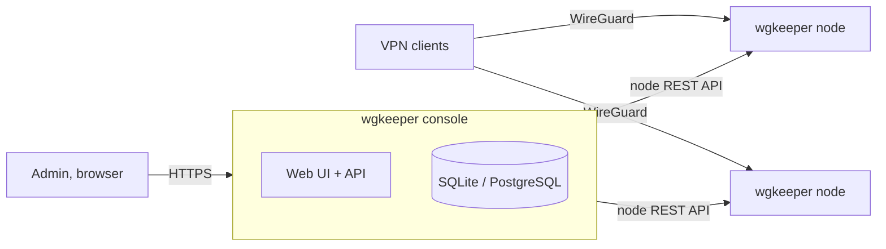

<p align="center">
  
</p>

<p align="center">Web admin console for managing wgkeeper nodes and WireGuard peers.</p>

<div align="center">

[](https://github.com/wgkeeper/wgkeeper-console/actions/workflows/ci.yml)
[](https://github.com/wgkeeper/wgkeeper-console/blob/main/LICENSE)
[](https://github.com/wgkeeper/wgkeeper-console/releases/latest)
[](https://github.com/wgkeeper/wgkeeper-console/pkgs/container/console)
[](https://scorecard.dev/viewer/?uri=github.com/wgkeeper/wgkeeper-console)

</div>

<p align="center">
  
</p>

---

wgkeeper console is a web admin panel for a fleet of [wgkeeper nodes](https://github.com/wgkeeper/wgkeeper-node). Add your nodes once, then create, inspect and revoke WireGuard peers on any of them from one place, and hand out ready-to-use client configs.

- One view of every node: online status, version, and a hint when a node is behind the latest release.
- Peers per node: who is active, last handshake, traffic, expiry.
- Client configs in one click, with your DNS servers, an expiry date and the address families you want; the private key is shown once and never stored.
- Revoke a peer and it's gone from the node immediately.
- Node API keys are encrypted at rest; sessions can be revoked; logins are rate limited. See [Security](docs/security.md).
- SQLite out of the box, PostgreSQL when you want it.
- Health checks, request IDs in every log line, and optional Prometheus metrics.

## How it works



The console stores nodes and their API keys (encrypted) and talks to each node over its REST API. Peers live on the nodes, not in the console: if the console is down, the VPN keeps working.

## Quick start

On a Linux server:

```bash
curl -fsSL https://raw.githubusercontent.com/wgkeeper/wgkeeper-console/main/scripts/install.sh | sudo bash
```

The [install script](scripts/install.sh) installs Docker if it's missing, puts the console into `/opt/wgkeeper-console` with a new secret key and admin password, starts it and prints how to log in. Add `-s -- --domain console.example.com` after `bash` to put Caddy with an automatic HTTPS certificate in front of it. Read the script first if you prefer; [Deployment](docs/deployment.md) also covers installing by hand, nginx, PostgreSQL and backups.

Without `--domain` the console listens on `127.0.0.1:8000` of the server only; open it through an SSH tunnel:

```bash
ssh -L 8000:127.0.0.1:8000 your-server   # then open http://127.0.0.1:8000
```

Log in as `admin` with the printed password, set a new one, and add a node with its address and API key.

## Documentation

- [Configuration](docs/configuration.md): requirements and every environment variable.
- [Deployment](docs/deployment.md): install script and updates, Docker Compose, reverse proxy (Caddy and nginx examples), PostgreSQL, backups, building from source.
- [Security](docs/security.md): what the console protects and how.
- [Metrics and logs](docs/metrics.md): health checks, request IDs, Prometheus metrics and alerting rules.

To report a vulnerability, see [SECURITY.md](SECURITY.md).

## Contributing

See [CONTRIBUTING.md](CONTRIBUTING.md) for setup, checks and the pull request flow.

## License

[AGPL-3.0](LICENSE).

WireGuard® is a registered trademark of Jason A. Donenfeld.
